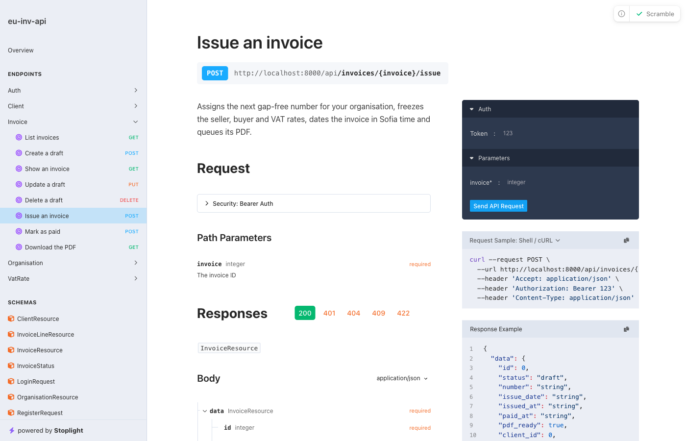
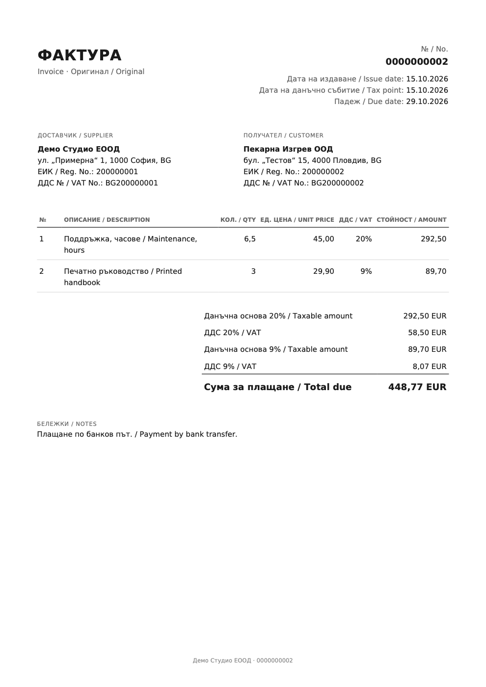

# eu-inv-api

[](https://github.com/JustBoryata/eu-inv-api/actions/workflows/ci.yml)

A multi-tenant REST API for issuing invoices that hold up under Bulgarian and EU rules. Each organisation gets gap-free invoice numbering, invoices are frozen once issued, VAT is broken down per rate, and PDFs are rendered on a queue.

Most invoicing demos skip the hard parts. This one is built around them:

- **Gap-free numbering under concurrency.** Two simultaneous "issue" calls never get the same number, and a failed issue never burns one. A test starts 8 real processes at once to prove it.
- **Immutable once issued.** The seller's and buyer's details and every VAT rate are copied onto the invoice, so editing a client later can't rewrite a legal document.
- **Tenant isolation.** Every query is scoped to the caller's organisation. Another tenant's record answers 404, not 403, so its existence isn't leaked.
- **Correct money.** Integer cents, `BcMath\Number` for quantities, and VAT rounded once per rate.

Built with Laravel 13, PHP 8.4, PostgreSQL 18 and Redis 8.

| API docs (generated from the code) | Sample invoice PDF |
| --- | --- |
| [](docs/images/api-docs.png) | [](docs/sample-invoice.pdf) |

## Quickstart

You need Docker. Everything else runs in containers. The examples below also use `jq`.

```sh
git clone https://github.com/JustBoryata/eu-inv-api.git
cd eu-inv-api
cp .env.example .env
docker compose build
docker compose run --rm app composer install
docker compose run --rm app php artisan key:generate
docker compose up -d
docker compose exec app php artisan migrate --seed
```

`composer install` runs before `up` because the source folder, including `vendor/`, is mounted into the containers, and the app and queue worker can't start without it.

The API is now at <http://localhost:8000/api>, with interactive docs at <http://localhost:8000/docs/api>. The seeder creates a made-up organisation with two clients and one draft, one issued and one paid invoice. Log in as `demo@example.com` with the password `demo-password`.

### Try it

```sh
# Log in and keep the token
TOKEN=$(curl -s localhost:8000/api/auth/login \
  -H 'Accept: application/json' -H 'Content-Type: application/json' \
  -d '{"email":"demo@example.com","password":"demo-password","device_name":"cli"}' | jq -r .token)

auth=(-H "Authorization: Bearer $TOKEN" -H 'Accept: application/json')

# List invoices; the draft has no number yet
curl -s localhost:8000/api/invoices "${auth[@]}" | jq -c '.data[] | {id, status, number}'

# Issue the draft: it gets the next number and its PDF is queued
DRAFT=$(curl -s 'localhost:8000/api/invoices?status=draft' "${auth[@]}" | jq '.data[0].id')
curl -s -X POST localhost:8000/api/invoices/$DRAFT/issue "${auth[@]}" | jq -c '.data | {number, issue_date, pdf_ready}'

# Download the PDF. Expect 202 for a second or two while the worker renders it, then 200.
curl -s localhost:8000/api/invoices/$DRAFT/pdf "${auth[@]}" -o invoice.pdf -w '%{http_code}\n'
```

Money is in integer cents (`unit_price: 4500` is 45.00 EUR). VAT rates and quantities are decimal strings, so `"9.00"` never comes back as `8.999999`.

### Run the checks

```sh
docker compose exec app composer test      # Pest, against a real Postgres test database
docker compose exec app composer analyse   # Larastan at max level
docker compose exec app composer lint      # Pint
```

## API

| Method and path | What it does |
| --- | --- |
| `POST /api/auth/register` | Creates an organisation and its first user, returns a token |
| `POST /api/auth/login`, `POST /api/auth/logout` | Tokens expire after 7 days; logout revokes only the current one |
| `GET`/`PATCH /api/organisation` | The seller's details (registration number and address are needed to issue) |
| `GET /api/vat-rates` | Rates for the organisation's country (BG: 20%, 9%, 0%) |
| `/api/clients` | CRUD with search and pagination. A client with invoices can't be deleted (409) |
| `/api/invoices` | CRUD for drafts, filter by status, client and date. Issued invoices answer 409 to edits |
| `POST /api/invoices/{id}/issue` | Draft to issued: number, snapshot, date, queue the PDF |
| `POST /api/invoices/{id}/mark-paid` | Issued to paid |
| `GET /api/invoices/{id}/pdf` | The PDF, or `202 Accepted` with `Retry-After` while it's rendering |

The full OpenAPI 3.1 document is generated with [Scramble](https://scramble.dedoc.co) and committed as [`openapi.json`](openapi.json). CI fails if it drifts from the code.

## Architecture

```
HTTP ─► routes/api.php ─► FormRequest (validation, tenant-aware exists rules)
                       ─► Controller (thin)
                       ─► Action (IssueInvoice, MarkInvoicePaid, …)   ◄─ business rules live here
                       ─► Eloquent models + BelongsToOrganisation global scope
                       ─► JsonResource (response shape)

IssueInvoice ─► DB::transaction { lock draft → lock sequence row → next number → snapshot → save }
             ─► afterCommit: RenderInvoicePdf ─► Redis queue ─► worker ─► dompdf ─► storage
```

### Key decisions

| Decision | Why | Rejected alternative |
| --- | --- | --- |
| One database, an `organisation_id` column and a global scope | The simplest tenancy that is still correct at this size, and easy to test | Schema per tenant, or a tenancy package: too much machinery for v1 |
| The number is assigned when an invoice is **issued**, not when the draft is created | Deleting a draft never leaves a gap | Numbering drafts |
| A per-organisation `invoice_sequences` row locked with `SELECT … FOR UPDATE` | Concurrent issues queue up on the lock, and a rollback returns the number | A Postgres `SEQUENCE` isn't transactional, so a rollback leaves a gap. `MAX(number) + 1` races |
| A unique index on `(organisation_id, number)` and check constraints | The database enforces the rules even if the application has a bug | Trusting application code alone |
| Seller, buyer and VAT rates copied onto the invoice at issue | A later edit can't change a legal document | Joining live data when rendering |
| An `issue_date` in Europe/Sofia time next to the UTC `issued_at` | An invoice issued at 00:30 in Sofia isn't dated the day before | Deriving the date from UTC |
| Money as `bigint` cents, quantities as `numeric(12,3)`, maths in `BcMath\Number` | No float rounding; VAT is rounded once per rate, half away from zero | Floats |
| The PDF job is dispatched `afterCommit`, is unique per invoice and can run any number of times | A worker never sees a rolled-back invoice, and polling `GET /pdf` can safely re-dispatch it | Rendering inside the request |
| Pest on PostgreSQL, locally and in CI | Locking and constraints are what this project is about, and SQLite behaves differently | SQLite in memory |

## Not in v0.1.0

Each of these is a GitHub issue:

- Credit notes. An issued invoice is corrected with a credit note, never edited.
- The legal basis that 0% VAT lines must state, and reverse charge for EU business customers.
- Multiple currencies (v1 uses EUR, which Bulgaria has used since 2026-01-01), multiple users per organisation, and emailing invoices.
- VAT number validation against VIES.
- Production images and a deployment.

## License

[MIT](LICENSE)
